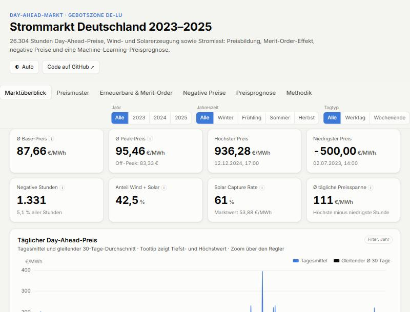
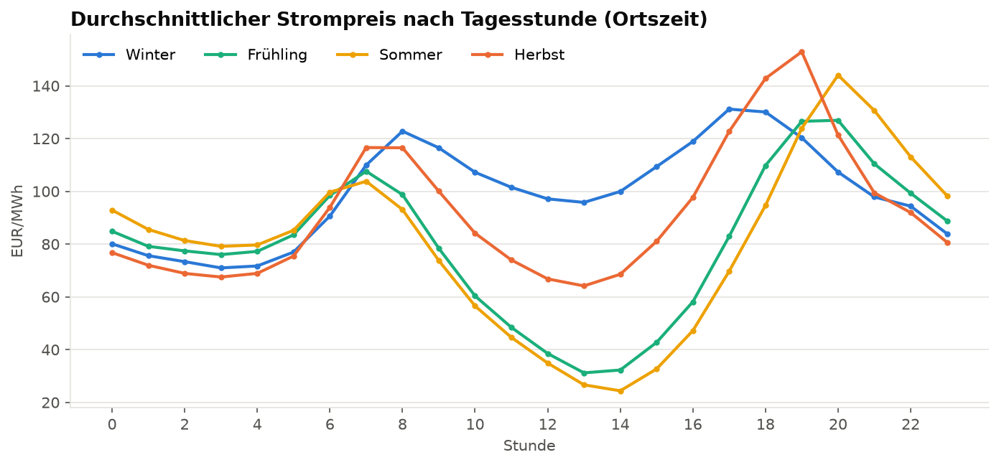
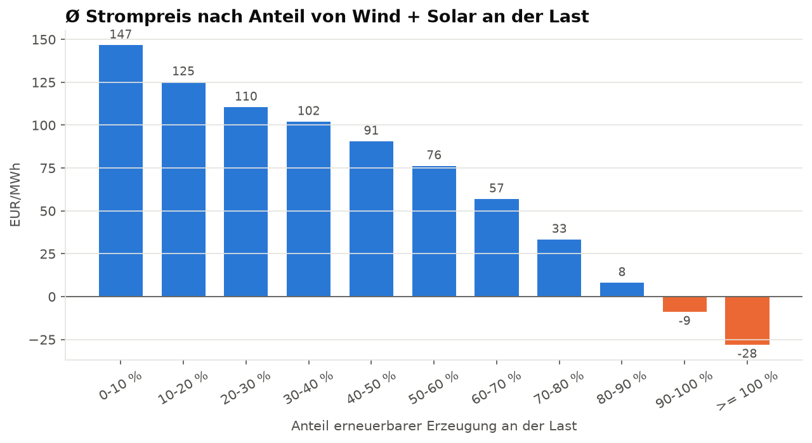
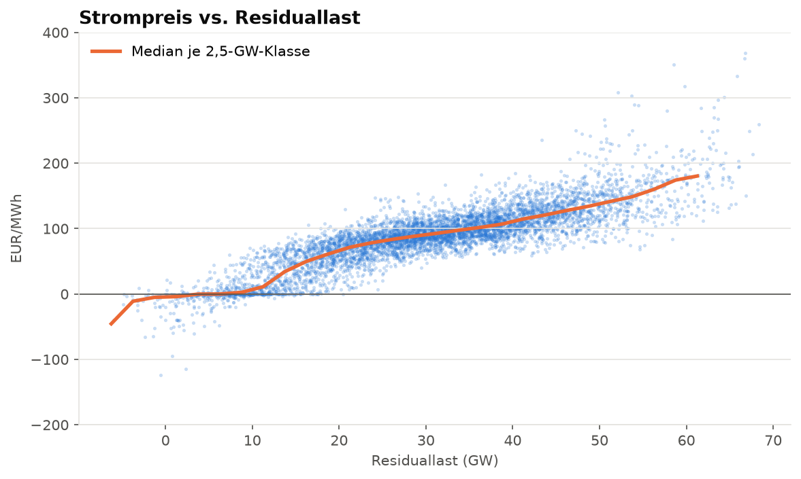
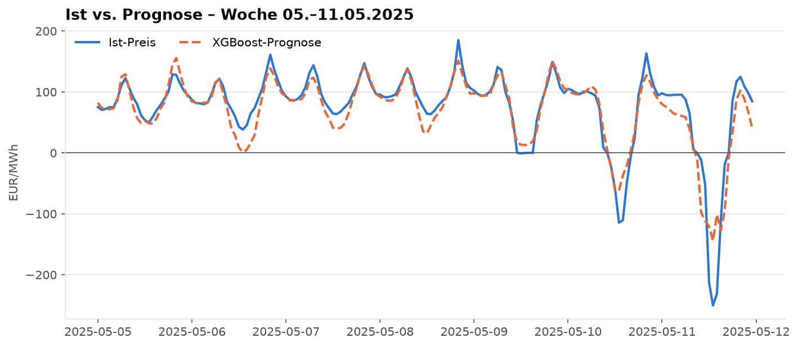
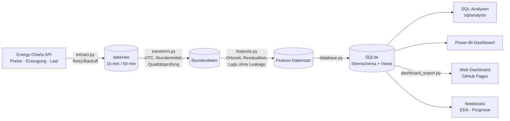
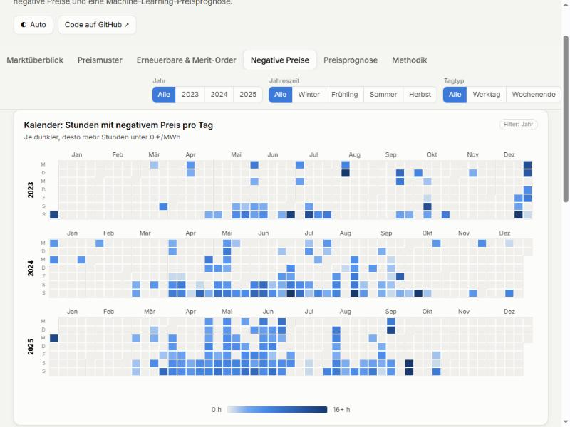
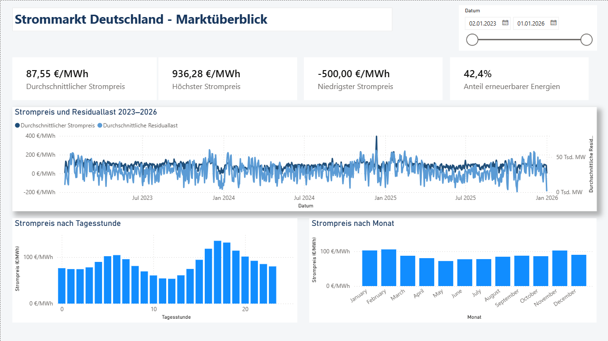

# ⚡ Energy Analytics – Deutscher Day-Ahead-Strommarkt 2023–2025

[](https://github.com/kreik-ship-it/energy_analytics_dashboard/actions/workflows/ci.yml)


End-to-end-Analyseprojekt zum deutschen Strommarkt: von der **API-Datenpipeline**
über ein **SQL-Datenmodell** und eine **explorative Analyse** bis zur
**Preisprognose mit Machine Learning** und einem **Power-BI-Dashboard**.

Untersucht werden 26.304 Stunden Day-Ahead-Preise der Gebotszone DE-LU zusammen
mit Wind- und Solarerzeugung sowie der Stromlast.

### 👉 [Live-Dashboard öffnen](https://kreik-ship-it.github.io/energy_analytics_dashboard/)

Das interaktive Web-Dashboard hat sechs Ansichten, lässt sich nach Jahr,
Jahreszeit und Tagtyp filtern und bietet einen Hell- und Dunkelmodus. Es läuft im
Browser, ohne Installation.

[](https://kreik-ship-it.github.io/energy_analytics_dashboard/)

---

## Kernergebnisse

| | 2023 | 2024 | 2025 |
|---|---:|---:|---:|
| Ø Day-Ahead-Preis (EUR/MWh) | 95,18 | 78,51 | 89,32 |
| Höchster Preis (EUR/MWh) | 524,27 | 936,28 | 583,40 |
| Stunden mit negativem Preis | 301 | 457 | 576 |
| Anteil Wind + Solar an der Last | 42,2 % | 42,1 % | 43,2 % |

1. **Die Residuallast bestimmt den Preis.** Wind und Solar allein korrelieren nur
   moderat mit dem Preis (r = −0,35 bzw. −0,43), die Residuallast
   (Last − Wind − Solar) dagegen stark (r = 0,83). Das ist der Merit-Order-Effekt:
   Je mehr konventionelle Kraftwerke laufen müssen, desto teurer wird Strom.
2. **Ab ca. 90 % EE-Anteil wird Strom im Mittel negativ bepreist.** Bei 0–10 %
   Wind + Solar kostet die MWh im Schnitt 147 EUR, bei 80–90 % nur noch 8 EUR.
3. **Negative Preise nehmen jedes Jahr zu** (+52 % 2024, +26 % 2025). 2025 lagen
   80 % davon zwischen 10 und 16 Uhr: Sie sind ein Solarphänomen, das vor allem
   an Wochenenden auftritt.
4. **„Duck Curve“:** Im Sommer fällt der Preis mittags auf ~25 EUR/MWh und steigt
   abends auf ~145 EUR/MWh. Diese Spreizung macht Batteriespeicher wirtschaftlich.
5. **Prognose:** Ein XGBoost-Modell sagt die Preise des Testjahres 2025 mit einem
   MAE von **15,2 EUR/MWh** vorher. Das sind **41 % weniger Fehler** als die naive
   Vortagsprognose (26,0 EUR/MWh).

<p float="left">
  
  
</p>
<p float="left">
  
  
</p>

---

## Architektur



| Schicht | Umsetzung |
|---|---|
| **Extract** | Client für die Energy-Charts API mit jahresweisem Abruf und exponentiellem Backoff bei Rate-Limits (HTTP 429) |
| **Transform** | Harmonisierung von 15- und 60-Minuten-Daten, Aggregation in UTC (keine Lücken/Duplikate bei der Zeitumstellung), automatisierter Qualitätsreport |
| **Features** | Kalendermerkmale in deutscher Ortszeit, Residuallast, EE-Anteil, Lag- und Rolling-Features ausschließlich aus Vergangenheitswerten |
| **Load** | SQLite im Sternschema (`energy_data` + `dim_date`), Indizes, Views für Tages- und Monatsaggregate |
| **Analyse** | 8 SQL-Analysen (CTEs, Window Functions, bedingte Aggregation), 5 Jupyter-Notebooks |
| **Qualität** | 24 Unit-Tests (u. a. Zeitumstellung, Leakage, alle SQL-Dateien), Linting mit Ruff, GitHub-Actions-CI |

---

## Notebooks

| Notebook | Inhalt |
|---|---|
| [01 – Datenbeschaffung](notebooks/01_data_acquisition.ipynb) | API-Struktur, Zeitzonen, Wechsel auf 15-Minuten-Preise (10/2025), Qualitätsprüfung |
| [02 – Explorative Analyse](notebooks/02_exploratory_data_analysis.ipynb) | Preisentwicklung, Tages-/Saisonmuster, Merit-Order, negative Preise, Autokorrelation |
| [03 – Feature Engineering](notebooks/03_feature_engineering.ipynb) | Fachliche Herleitung der Features, Prüfung auf Look-Ahead-Bias, Multikollinearität |
| [04 – SQL-Analyse](notebooks/04_sql_analysis.ipynb) | Datenmodell, alle SQL-Abfragen mit Ergebnissen |
| [05 – Preisprognose](notebooks/05_price_forecasting.ipynb) | Baselines vs. lineare Regression vs. XGBoost, Fehleranalyse, Feature Importance |

### Prognosemodelle (Testjahr 2025, out-of-sample)

| Modell | MAE | RMSE |
|---|---:|---:|
| Naiv: Preis vom Vortag | 25,97 | 40,45 |
| Naiv: Preis der Vorwoche | 32,83 | 49,33 |
| Lineare Regression | 15,96 | 23,71 |
| **XGBoost** | **15,21** | **23,22** |

Das Prognose-Setup bildet die Day-Ahead-Auktion realistisch ab: Da die Auktion für
Tag *D* am Mittag von *D−1* schließt, werden nur Preise ab einer Verzögerung von 24 h
verwendet (`price_lag_1` wäre ein Informationsleck). Training: 2023–2024, Test: 2025.

---

## SQL-Analysen

Alle Abfragen liegen als eigenständige Dateien unter [`sql/analysis`](sql/analysis)
und werden in der CI gegen eine Testdatenbank ausgeführt.

| Datei | Fragestellung | Techniken |
|---|---|---|
| `01_data_quality.sql` | Ist die Stundenreihe vollständig und eindeutig? | `LAG`, Subqueries |
| `02_price_kpis_by_year.sql` | Wie entwickeln sich Preisniveau und negative Preise? | Aggregation, `LAG` über Gruppen |
| `03_hourly_profile_by_season.sql` | Wie sieht das Tagesprofil je Jahreszeit aus? | Bedingte Aggregation (Pivot) |
| `04_price_by_renewable_share.sql` | Wie stark senken Wind und Solar den Preis? | CTE, Bucketing |
| `05_residual_load_segments.sql` | Preis in Abhängigkeit der Residuallast | `CASE`-Segmentierung |
| `06_negative_price_days.sql` | An welchen Tagen gab es die meisten negativen Preise? | CTE, `RANK()` |
| `07_monthly_trend.sql` | Monatstrend, gleitender Durchschnitt, Vorjahresvergleich | `AVG() OVER (ROWS …)`, `LAG(…, 12)` |
| `08_weekday_vs_weekend.sql` | Unterschiede zwischen Werktag und Wochenende | Mehrdimensionale Gruppierung |

---

## Dashboards

### Web-Dashboard ([live](https://kreik-ship-it.github.io/energy_analytics_dashboard/))

[`docs/index.html`](docs/index.html) ist eine eigenständige Seite auf Basis von
Apache ECharts. Sie liest die kompakte Datei `docs/data/dashboard.json` und
berechnet alle Kennzahlen direkt im Browser. Filter lassen sich deshalb frei
kombinieren, ohne dass ein Server nötig ist.

| Ansicht | Inhalt |
|---|---|
| Marktüberblick | 8 KPIs mit Vorjahresvergleich (Base, Peak, Extremwerte, negative Stunden, EE-Anteil, Solar Capture Rate, Tagesspanne), Preisverlauf mit synchron gezoomter Residuallast, Monatsvergleich, Erzeugungsmix |
| Preismuster | „Duck Curve“ je Jahreszeit, Heatmaps Stunde × Monat und Stunde × Wochentag, Preisverteilung |
| Erneuerbare & Merit-Order | Preis vs. Residuallast mit Median-Kurve, Preis nach EE-Anteil, Marktwerte (Capture-Preise) von Solar und Wind |
| Negative Preise | Kalender-Heatmap über drei Jahre, Verteilung nach Uhrzeit und Monat, Top-10-Tage |
| Preisprognose | Ist vs. XGBoost 2025 (zoombar), Modellvergleich, Feature Importance, Fehleranalyse |
| Methodik | Pipeline, Datenqualität, Definitionen |



Daten aktualisieren: `python -m energy_analytics.dashboard_export`. Lokal öffnen
mit `python -m http.server -d docs` und anschließend `http://localhost:8000`.

### Power BI

Die Datei [`dashboard/energy_market_dashboard.pbix`](dashboard/energy_market_dashboard.pbix)
nutzt die SQLite-Datenbank als Quelle (Sternschema `energy_data` ↔ `dim_date`).
Für den Ausbau zum mehrseitigen Report liegen unter
[`dashboard/powerbi`](dashboard/powerbi) bereit:

* [`measures.dax`](dashboard/powerbi/measures.dax): über 40 Measures und berechnete
  Spalten, u. a. Peak/Off-Peak, Capture-Preise, Vorjahresvergleich mit Time
  Intelligence, gleitende Durchschnitte, dynamische Titel und Prognosefehler
* [`energy_theme.json`](dashboard/powerbi/energy_theme.json): Theme mit denselben
  Farben wie das Web-Dashboard
* [`BAUANLEITUNG.md`](dashboard/powerbi/BAUANLEITUNG.md): Seitenplan mit 5 Seiten,
  Drillthrough „Tagesdetail“ und Tooltip-Seite



---

## Schnellstart

```bash
git clone https://github.com/kreik-ship-it/energy_analytics_dashboard.git
cd energy_analytics_dashboard
python -m venv .venv
.venv\Scripts\activate          # Linux/macOS: source .venv/bin/activate
pip install -e ".[analysis,dev]"
```

Die fertige Datenbank liegt im Repository (`database/energy_analytics.db`). Die
Notebooks 02–05 laufen deshalb sofort. Um die Daten selbst neu zu laden und
aufzubereiten:

```bash
python -m energy_analytics.pipeline --refresh
```

Tests und Linting:

```bash
pytest
ruff check src tests
```

## Projektstruktur

```
├── src/energy_analytics/     # Python-Paket: Pipeline, Features, DB, Modellierung
│   ├── extract.py            #   API-Client
│   ├── transform.py          #   Bereinigung, Stundenaggregation, Qualitätsreport
│   ├── features.py           #   Feature Engineering
│   ├── database.py           #   SQLite-Sternschema, SQL-Helfer
│   ├── modeling.py           #   Prognose-Features, Split, Metriken
│   ├── dashboard_export.py   #   JSON fürs Web-Dashboard + Prognosetabellen
│   └── pipeline.py           #   CLI: python -m energy_analytics.pipeline
├── sql/
│   ├── views.sql             # Views für Power BI
│   └── analysis/             # 8 Analyseabfragen
├── notebooks/                # 01–05: Daten, EDA, Features, SQL, Prognose
├── tests/                    # Unit-Tests (pytest)
├── database/                 # SQLite-Datenbank (Quelle für Power BI)
├── dashboard/                # Power-BI-Datei, Theme, DAX-Measures, Bauanleitung
└── docs/                     # Web-Dashboard (GitHub Pages) und Grafiken
```

## Methodische Entscheidungen

* **Zeitzonen:** Die Verarbeitung erfolgt in UTC, Kalendermerkmale werden in
  `Europe/Berlin` abgeleitet. So bleiben Tagesprofile korrekt und die
  Zeitumstellung erzeugt keine Lücken oder Duplikate.
* **15-Minuten-Preise:** Seit 01.10.2025 werden Day-Ahead-Preise viertelstündlich
  gehandelt. Sie werden zu Stundenmittelwerten aggregiert, damit die Zeitreihe
  über den gesamten Zeitraum vergleichbar bleibt.
* **Extremwerte** (−500 bis 936 EUR/MWh) sind echte Marktereignisse und werden
  nicht entfernt.
* **Kein Look-Ahead-Bias:** Rolling-Features basieren auf `shift(1)`, das
  Prognosemodell nur auf Informationen, die zum Auktionszeitpunkt bekannt sind.
* **Lag-Historie:** Die Pipeline lädt 8 Tage Vorlauf. Dadurch sind die Features
  ab der ersten Stunde des Jahres 2023 vollständig.

## Grenzen und Ausblick

* Für Wind, Solar und Last werden Ist-Werte statt der am Vortag verfügbaren
  Prognosen genutzt. Die Prognosegüte ist daher eine Obergrenze. Als nächster
  Schritt sollten die Prognosedaten der ENTSO-E Transparency Platform angebunden werden.
* Brennstoff- und CO₂-Preise (Gas, EU-ETS) sowie Feiertage fehlen als Features.
* Die Validierung beruht auf einem einzigen Testjahr. Robuster wäre eine
  Walk-Forward-Validierung.

## Datenquelle

Daten über die [Energy-Charts API](https://api.energy-charts.info/) des Fraunhofer ISE.
Ursprung: Bundesnetzagentur | SMARD.de, Lizenz
[CC BY 4.0](https://creativecommons.org/licenses/by/4.0/).
